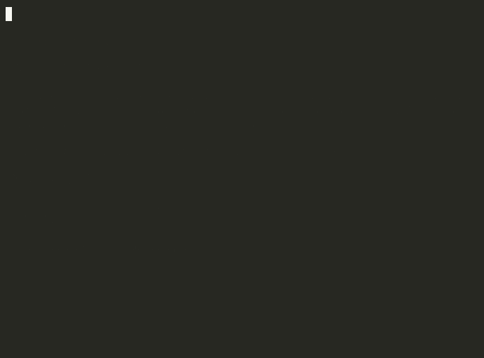

<h1 align="center">vibesurfer (<code>vs</code>)</h1>

<p align="center"><strong>A browser for LLMs, not humans.</strong></p>

<p align="center">
  <a href="https://github.com/frane/vibesurfer/actions/workflows/ci.yml"></a>
  <a href="https://github.com/frane/vibesurfer/actions/workflows/engine-tests.yml"></a>
  <a href="https://github.com/frane/vibesurfer/releases/latest"></a>
  <a href="https://www.npmjs.com/package/vibesurfer"></a>
  <a href="https://crates.io/crates/vibesurfer"></a>
  <a href="https://github.com/frane/vibesurfer/blob/main/LICENSE"></a>
</p>

<p align="center">
  
</p>

Browsers and their automation protocols were built for people looking at DevTools. An agent pays per token and waits on every response. The Hacker News front page through Playwright is about 2000 tokens before the agent has done anything; through vibesurfer it is about 50.

vibesurfer is a native browser daemon in Rust on the real system engine: WKWebView on macOS, WebKitGTK on Linux, WebView2 on Windows. No Chromium download.

- **Small reads.** A page is a compact accessibility tree with stable refs. Later reads send only what changed.
- **No stale clicks.** Every read returns a state token, and every write checks it. If the page moved in between, the agent reads again instead of clicking the wrong thing.
- **Real input.** Clicks, drags and typing are native OS events (`isTrusted = true`) on every engine. See [stealth](https://github.com/frane/vibesurfer/blob/main/docs/stealth.md).
- **Secrets stay with the human.** `vs prompt-form` collects a login through a local form your password manager fills; the agent never sees the values.
- **Everything else a browser test needs:** request interception, dialogs and popups, cookies and saved logins, downloads, screenshots, MP4 and WebM recording, a live view to watch the agent, WebAuthn passkeys.
- **Audited.** Every call is a row in a local SQLite log.

## Install

```
npx vibesurfer session-open                  # no install
brew tap frane/tap && brew install vibesurfer
cargo install vibesurfer
```

More ways, and what each platform needs: [docs/install.md](https://github.com/frane/vibesurfer/blob/main/docs/install.md).

## Use it from your agent

```
vs skill install
```

This finds Claude Code, Claude Desktop, Cursor, Codex, Antigravity and OpenClaw and gives each the skill file, the MCP server, or both. In Claude Code, `/plugin install frane/vibesurfer` does the same.

## Thirty seconds

```
$ vs so                                       # session-open
$ vs o https://example.com                    # open -> page id
p_019e…
$ vs v p_019e…                                # view
@44d01704049d6d31
1 doc "Example Domain"
  2 hd "Example Domain"
  4 lnk "Learn more" click,focus
$ vs a p_019e… 4 click --token=44d01704049d6d31
```

More in [docs/usage.md](https://github.com/frane/vibesurfer/blob/main/docs/usage.md). The full command reference agents read is [SKILL.md](https://github.com/frane/vibesurfer/blob/main/skills/vibesurfer/SKILL.md).

## testsurfer

[testsurfer](https://github.com/frane/testsurfer) runs your existing `@playwright/test` suites on vibesurfer: 11 MB to install instead of about 300 MB.

## Docs

[Install](https://github.com/frane/vibesurfer/blob/main/docs/install.md) · [Usage](https://github.com/frane/vibesurfer/blob/main/docs/usage.md) · [Stealth](https://github.com/frane/vibesurfer/blob/main/docs/stealth.md) · [Protocol](https://github.com/frane/vibesurfer/blob/main/docs/PROTOCOL.md) · [Architecture](https://github.com/frane/vibesurfer/blob/main/docs/ARCHITECTURE.md) · [Known issues](https://github.com/frane/vibesurfer/blob/main/docs/known-issues.md) · [Development](https://github.com/frane/vibesurfer/blob/main/docs/DEVELOPMENT.md) · [Changelog](https://github.com/frane/vibesurfer/blob/main/CHANGELOG.md)

## License

Apache-2.0. Built on [objc2](https://github.com/madsmtm/objc2), [webkit6](https://github.com/gtk-rs/gtk-rs-core), [webview2-com](https://github.com/wravery/webview2-rs) and [interprocess](https://github.com/kotauskas/interprocess). Contributions welcome; open an issue first for anything beyond a small fix.
